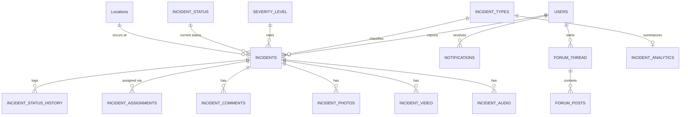

# Incident Reporting System

A role-based web application for reporting, resolving and analyzing incidents on a campus. Users report incidents with photo, video and audio evidence. Admins and responders triage and resolve them, and analysts study the data to find patterns.

It is also a database-focused learning project. The emphasis is on relational design, data integrity, transactions, reducing redundancy and keeping data accurate under concurrent use.


## Table of Contents

- [Features](#features)
- [Tech Stack](#tech-stack)
- [Project Structure](#project-structure)
- [Getting Started](#getting-started)
- [Demo Accounts](#demo-accounts)
- [Database Design](#database-design)
- [API Overview](#api-overview)
- [Security Notes](#security-notes)
- [Known Issues and Roadmap](#known-issues-and-roadmap)

## Features

| Role | What they can do |
|------|------------------|
| **User** | Register, report incidents (with up to 5 photos, 2 videos and 2 audio files), mark incidents public or private, track status, comment, receive notifications, browse public incidents, and post in the community forum (optionally anonymously, with like/dislike reactions) |
| **Responder** | See assigned incidents, update status, resolve incidents and comment |
| **Admin** | See all incidents, assign responders, approve or deactivate accounts, change user roles, leave internal comments and view analytics |
| **Analyst** | See all incidents, leave internal comments and explore the analytics dashboards |

**Other highlights**

- **Account approval:** only `User` accounts are active on registration. Responder, Admin and Analyst sign-ups wait for approval.
- **Domain-restricted sign-up:** only `@buet.ac.bd`, `@ugrad.buet.ac.bd`, `@cse.buet.ac.bd` and `@dmp.bd` emails are accepted.
- **Full audit trail:** every status change is logged with who made it and when.
- **Automatic notifications** on status changes, assignments and staff comments.
- **Automatic severity:** an incident takes its type's default severity unless one is chosen.
- **Analytics:** hotspots by location, stats by type, time trends, severity and status distribution, resolution times, day-of-week and hourly patterns, attachment stats, forum activity and public/private ratio.
- **Password recovery** with a time-limited 6-digit verification code (10 minutes).

## Tech Stack

| Layer | Technology |
|-------|------------|
| Backend | Node.js, Express 4 |
| Database | PostgreSQL (via `pg`), PL/pgSQL triggers, functions and procedures |
| Auth | JSON Web Tokens (`jsonwebtoken`), password hashing with `bcrypt` |
| File uploads | `multer` (disk storage) |
| Frontend | Plain HTML, CSS and JavaScript, served statically by Express |

## Project Structure

```
IncidentReportingSystem/
├── backend/
│   ├── server.js            # Express app: auth, RBAC, REST API, uploads
│   └── uploads/             # User-uploaded evidence (created at runtime)
├── database/
│   ├── main.sql             # Table definitions and constraints
│   ├── seed.sql             # Sample data (campus locations, users, incidents)
│   ├── database_logic.sql   # Triggers, stored procedures and functions
│   └── setup_db.js          # One-command database (re)creation script
├── frontend/
│   ├── index.html           # Main single-page dashboard
│   ├── login.html
│   ├── register.html
│   ├── forgot-password.html
│   └── js/auth-guard.js     # Redirects unauthenticated visitors to login
├── .env.example             # Environment variable template
└── package.json
```

## Getting Started

### Prerequisites

- [Node.js](https://nodejs.org/) 18 or newer
- [PostgreSQL](https://www.postgresql.org/) 14 or newer (stored procedures need version 11+)

### 1. Clone and install

```bash
git clone https://github.com/bari4078/IncidentReportingSystem.git
cd IncidentReportingSystem
npm install
```

### 2. Configure the environment

```bash
cp .env.example .env
```

Edit `.env`:

| Variable | Description | Default |
|----------|-------------|---------|
| `DB_HOST` | PostgreSQL host | `localhost` |
| `DB_PORT` | PostgreSQL port | `5432` |
| `DB_NAME` | Database name | `dbms_project` |
| `DB_USER` | Database user | `postgres` |
| `DB_PASSWORD` | Database password | none, required |
| `JWT_SECRET` | Secret used to sign tokens (the server will not start without it) | none, required |
| `JWT_EXPIRES_IN` | Token lifetime | `24h` |
| `PORT` | Server port | `3000` |

Generate a strong secret with:

```bash
node -e "console.log(require('crypto').randomBytes(64).toString('hex'))"
```

### 3. Create the database

```bash
node database/setup_db.js
```

> **Warning:** this script **drops and recreates** the `dbms_project` database if it already exists. Never run it against data you want to keep.

It creates the database, applies `main.sql`, loads `seed.sql`, then installs `database_logic.sql`.

### 4. Start the server

```bash
npm start
```

Open **http://localhost:3000** and sign in.

## Demo Accounts

The seed data includes these accounts for local testing only:

| Role | Email | Password |
|------|-------|----------|
| Admin | `authority@buet.ac.bd` | `hashed_pass_auth` |
| Responder | `water.tech@buet.ac.bd` | `password@123` |
| Analyst | `system.analyst@buet.ac.bd` | `hashed_pass_analyst` |
| User | `student1@ugrad.buet.ac.bd` | `hashed_pass_student1` |

The seed stores these as plaintext. On a user's first login the server accepts the password once and replaces it with a bcrypt hash. **Delete or change these accounts before any real deployment.**

## Database Design

### Entity overview



### Normalization

Repeating values live in lookup tables (`SEVERITY_LEVEL`, `INCIDENT_STATUS`, `INCIDENT_TYPES`, `Locations`) and are referenced by foreign key rather than stored as text on every incident. Evidence files get their own tables (`INCIDENT_PHOTOS`, `INCIDENT_VIDEO`, `INCIDENT_AUDIO`), and history, assignments and comments are separate one-to-many tables.

### Integrity constraints

- `CHECK` constraints restrict roles (`User`, `Admin`, `Analyst`, `Responder`), severity names, status names and notification types.
- `UNIQUE` email on users and one analytics row per incident type.
- Foreign keys with explicit `ON DELETE` behaviour: `CASCADE` for dependent incident data, `SET NULL` for notification links.
- `TIMESTAMPTZ` timestamps and `NOT NULL` on required fields.

### Triggers

| Trigger | Fires on | Purpose |
|---------|----------|---------|
| `trg_update_last_updated_time` | `INCIDENTS` update | Keeps `Last_updated_time` accurate |
| `trg_log_status_change` | `INCIDENTS` status update | Writes a row to `INCIDENT_STATUS_HISTORY` |
| `trg_ensure_single_active_assignment` | `INCIDENT_ASSIGNMENTS` insert | Deactivates earlier assignments so only one is active per incident |
| `trg_notify_status_change` | `INCIDENT_STATUS_HISTORY` insert | Notifies the reporter of the new status |
| `trg_notify_new_comment` | `INCIDENT_COMMENTS` insert | Notifies the reporter when staff comment |

### Stored procedures and functions

| Name | Purpose |
|------|---------|
| `assign_responder(incident, responder, assigned_by)` | Creates the assignment, sets status to *Assigned* and records who did it |
| `update_incident_status(incident, new_status, changed_by)` | Changes status and attributes the history entry to the actor |
| `resolve_incident(incident, resolver)` | Marks the incident *Resolved*, closes assignments and adds an internal note |
| `get_overall_stats()` | Returns totals per status and average resolution time in hours |

### Transactions

Every write endpoint in the API runs inside an explicit `BEGIN` / `COMMIT` block on a pooled client, with `ROLLBACK` on any error. Multi-step operations such as reporting an incident with attachments are therefore all-or-nothing.

## API Overview

All `/api` routes require `Authorization: Bearer <token>` except the public auth routes.

**Authentication** (public unless noted)

| Method | Endpoint | Description |
|--------|----------|-------------|
| POST | `/api/auth/register` | Create an account |
| POST | `/api/auth/login` | Log in and receive a JWT |
| POST | `/api/auth/forgot-password` | Request a verification code |
| POST | `/api/auth/verify-code` | Verify the code |
| POST | `/api/auth/reset-password` | Set a new password |
| POST | `/api/auth/change-password` | Change password (authenticated) |
| GET | `/api/auth/user` | Current user |

**Incidents**

| Method | Endpoint | Description |
|--------|----------|-------------|
| GET | `/api/incidents` | List incidents |
| GET | `/api/incidents/:id` | Details with attachments |
| POST | `/api/incidents` | Report an incident (multipart upload) |
| POST | `/api/incidents/:id/status` | Change status |
| POST | `/api/incidents/:id/assignments` | Assign a responder (**Admin, Responder**) |
| GET | `/api/incidents/:id/history` | Status history |
| GET / POST | `/api/incidents/:id/comments` | Read or add comments |

**Users** (**Admin** only)

| Method | Endpoint | Description |
|--------|----------|-------------|
| PUT | `/api/users/:id/status` | Activate or deactivate an account |
| PUT | `/api/users/:id/role` | Change a user's role |

**Analytics, notifications and forum**

| Method | Endpoint | Description |
|--------|----------|-------------|
| GET | `/api/analytics` | Overall statistics |
| GET | `/api/analytics/...` | `hotspots/location`, `stats/type`, `trends/time`, `correlation`, `severity-dist`, `status-dist`, `resolution-times`, `user-activity`, `day-of-week`, `hourly-trend`, `attachment-stats`, `forum-activity`, `public-ratio` |
| GET | `/api/users/:user_id/notifications` | A user's notifications |
| PUT | `/api/notifications/:id/read` | Mark a notification read |
| GET / POST | `/api/forum/threads` | List or create threads |
| GET | `/api/forum/threads/:id` | Thread with posts |
| POST | `/api/forum/threads/:id/posts` | Reply to a thread |
| POST | `/api/forum/posts/:id/react` | Like or dislike a post |

## Security Notes

- Passwords are hashed with bcrypt, and JWTs are verified on every `/api` request.
- Role-based access is enforced server-side with a `requireRole(...)` middleware.
- `.env` is git-ignored. Never commit real credentials.
- The password-reset code is currently **printed to the server console** instead of emailed (see below).

## Known Issues and Roadmap

- [ ] **Schema and code are out of sync.** `server.js` uses `FORUM_POST_REACTIONS` and the columns `FORUM_THREAD.Is_anonymous` and `FORUM_THREAD.Incident_id`, but `main.sql` does not create them. Creating threads and reacting to posts will fail on a fresh database until they are added.
- [ ] Add explicit concurrency control: choose isolation levels per operation (for example `SERIALIZABLE` for assignment and resolution) and row locking (`SELECT ... FOR UPDATE`) to prevent lost updates and double assignment.
- [ ] Apply `requireRole` to all state-changing endpoints. Several currently trust a `user_id` sent in the request body.
- [ ] Deliver verification codes by email or SMS. `nodemailer` and `twilio` are installed but not wired up.
- [ ] Remove unused dependencies (`jsdom`, `nodemailer`, `twilio`) or start using them.
- [ ] Move the in-memory verification-code store to the database or Redis.
- [ ] Split `server.js` into routes, controllers and services.
- [ ] Add automated tests and a CI workflow.
